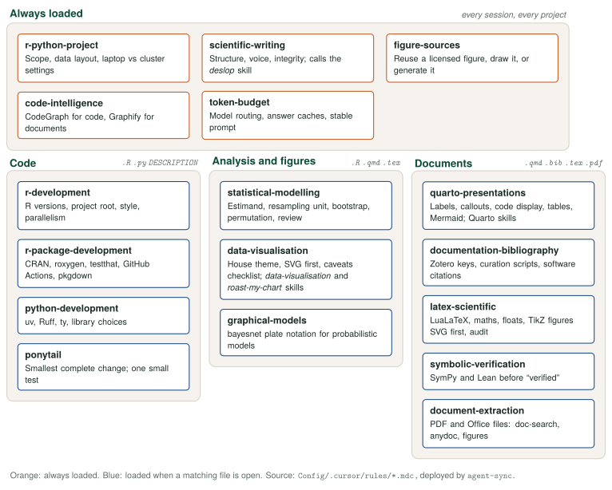
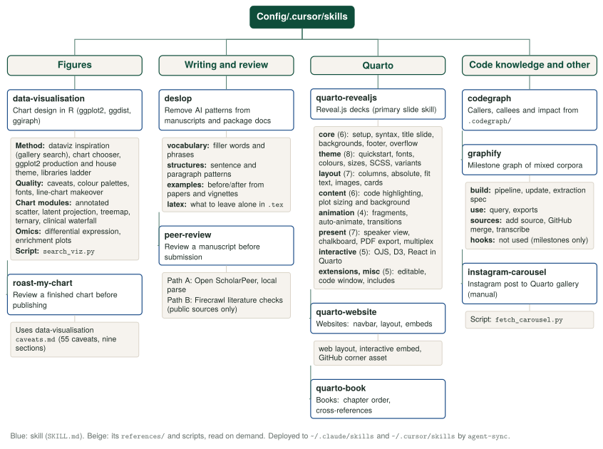

# Agent bundle (rules and skills)

Git source of truth for the **rules** (`rules/*.mdc`) and **skills**
(`skills/*/SKILL.md`) used by Cursor and Claude Code. Each repository's root
`AGENTS.md` says which rules it carries; `agent-sync` deploys them.





## Rules (`rules/`)

| Rule | Loads | Role |
| --- | --- | --- |
| `r-python-project` | always | Working scope, data layout, laptop vs cluster settings |
| `scientific-writing` | always | Structure, voice, integrity; invokes the deslop skill |
| `figure-sources` | always | Reuse a licensed figure, draw it, or generate it |
| `code-intelligence` | always | CodeGraph for code, Graphify for cross-document questions |
| `token-budget` | always | Model routing, answer caches, stable prompt prefix |
| `r-development` | `*.R` | R versions, project root, style, parallelism |
| `r-package-development` | `DESCRIPTION`, `tests/testthat`, `vignettes`, pkgdown, CI | CRAN, roxygen, testthat, GitHub Actions, pkgdown |
| `python-development` | `*.py`, `pyproject.toml` | uv, Ruff, ty, library choices |
| `ponytail` | code files | Smallest complete change |
| `statistical-modelling` | R, Quarto, LaTeX | Resampling, bootstrap, permutation, model review |
| `data-visualisation` | R, Quarto, LaTeX | House theme, SVG-first devices, caveats checklist |
| `quarto-presentations` | `*.qmd`, `_quarto.yml` | Labels, callouts, code display, tables, Mermaid |
| `documentation-bibliography` | `*.bib`, `*.qmd`, `*.tex`, `CITATION` | Zotero, citation keys, curation scripts, software citations |
| `latex-scientific` | `*.tex`, `article/` | LuaLaTeX, maths, floats, TikZ figures (SVG first), audit |
| `graphical-models` | `*.qmd`, `*.tex` | bayesnet plate notation for probabilistic models |
| `symbolic-verification` | `*.tex`, `*.qmd`, `verification/` | SymPy and Lean checks before "verified" |
| `document-extraction` | PDF and Office files | doc-search, anydoc, figures, confidentiality |

## Skills (`skills/`)

| Skill | Role |
| --- | --- |
| `data-visualisation` | Gallery search, chart chooser, ggplot2 production and house theme, caveats, colours, fonts, chart modules |
| `roast-my-chart` | Pre-publication review against the caveats (Holtz, MIT) |
| `deslop` | Remove AI patterns from manuscripts and package documentation |
| `peer-review` | Open ScholarPeer first; Firecrawl literature checks second; never uploads the manuscript |
| `quarto-revealjs` | Reveal.js decks: theme, layout, motion, presenting, OJS/D3/React |
| `quarto-website` | Quarto websites: navbar, layout, embeds, GitHub corner |
| `quarto-book` | Quarto books: chapter order, cross-references |
| `codegraph` | CodeGraph install and queries |
| `graphify` | Milestone knowledge graph of mixed corpora |
| `instagram-carousel` | Instagram post to Quarto lightbox gallery (manual only) |

Firecrawl skills are installed per machine from
[firecrawl/skills](https://github.com/firecrawl/skills) (API key needed) and
are never vendored or touched by `agent-sync`.

## agent-sync

```bash
export AGENT_BUNDLE_ROOT="/path/to/ubuntu-genesis/Config/.cursor"
"$AGENT_BUNDLE_ROOT/agent-sync/agent-sync.sh" install-user      # ~/.cursor and ~/.claude
"$AGENT_BUNDLE_ROOT/agent-sync/agent-sync.sh" verify            # every rule and skill identical
"$AGENT_BUNDLE_ROOT/agent-sync/agent-sync.sh" install-project R # packs from R/AGENTS.md
"$AGENT_BUNDLE_ROOT/agent-sync/agent-sync.sh" publish           # home edits back into the bundle
```

- `install-user` copies every rule and skill and records them in
  `.agent-sync-manifest`; a rule or skill removed from the bundle is removed
  from both homes on the next run. Unmanaged entries (Firecrawl symlinks,
  `synced/`, your own files) are never touched.
- `install-project` reads the `yaml` block of the repository's `AGENTS.md`
  (`packs:` from `agent-sync/agent-packs.yaml`, `project_rules: copy` or
  `symlink`). Copy mode writes `.cursor/rules/*.mdc` and `.claude/rules/*.md`,
  prunes stale bundle copies, and mirrors project-only `.cursor/rules` files
  to `.claude/rules`.
- Hooks (merge once per machine):
  [`claude-settings-hooks.snippet.json`](agent-sync/hooks/claude-settings-hooks.snippet.json)
  into `~/.claude/settings.json` (SessionStart `verify`, PostToolUse
  redeploy after an edit, PreToolUse `dataviz-nudge`);
  [`cursor-hooks.json.example`](agent-sync/hooks/cursor-hooks.json.example)
  into `~/.cursor/hooks.json`; and
  `git config core.hooksPath Config/.cursor/agent-sync/git/hooks` so a
  `git pull` redeploys. Cluster setup: [`agent-sync/CLUSTER.md`](agent-sync/CLUSTER.md).

## Also in this folder

- `code-knowledge/`: CodeGraph template and Graphify milestone scripts.
- `Code/User/`: VS Code / Cursor settings and keybindings templates.
- `extensions/list.txt`: editor extension IDs.
