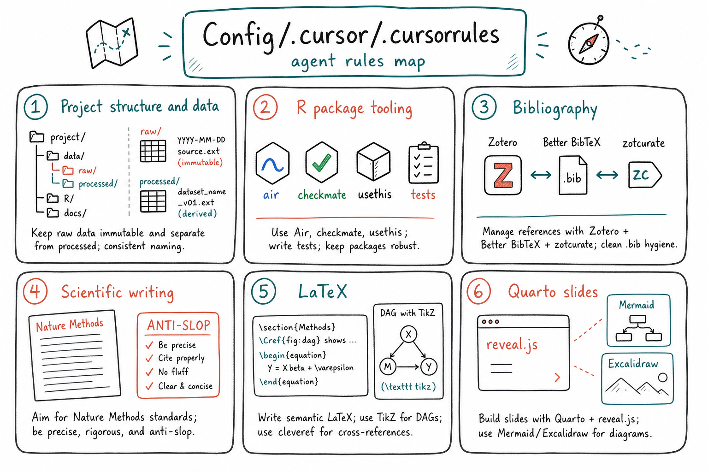

# Cursor configuration bundle (teaching_material)

Portable **rules** (`.mdc`) and **skills** (`SKILL.md`) for Cursor Agent,
split by domain instead of one `.cursorrules` file.

## Rules (`rules/`)

| File | When it applies |
|------|-----------------|
| `scope-workspace.mdc` | Always — scope, data, SSH/editor hosts |
| `statistical-modelling.mdc` | Always — CV, bootstrap, glmPerm, mlr3, review |
| `documentation-bibliography.mdc` | Always — Zotero, Quarto bib, intake |
| `scientific-writing.mdc` | Always — voice, figures, integrity |
| `r-development.mdc` | `*.R`, R packages — Air, pre-commit, ggplot2 |
| `python-development.mdc` | `*.py`, `pyproject.toml` — uv, Ruff, ty |
| `quarto-presentations.mdc` | `*.qmd`, slides — Mermaid, reveal.js |
| `latex-scientific.mdc` | `*.tex` — LuaLaTeX, TikZ, minted |
| `teaching-material-repo.mdc` | This Quarto book repo layout |

## Skills (`skills/`)

| Skill | Role |
|-------|------|
| `deslop` | De-AI prose (LaTeX-safe) |
| `peer-review-assistant` | Manuscript review workflow |
| `latex-modern-audit` | Modern LaTeX compliance check |
| `quarto-revealjs` (+ fragment, auto-animate) | Slide decks |
| `convert-documents-to-markdown` | Office/PDF → Markdown |
| `find-skills` | Discover third-party skills |
| `instagram-carousel` | Carousel copy/layout |
| `firecrawl` | **Pointer only** — install from [firecrawl/skills](https://github.com/firecrawl/skills) |

Firecrawl sub-skills are **not** vendored here (repo size, API keys). Follow
`skills/firecrawl/SKILL.md`.

## Installation

```bash
TEACHING_CONFIG="/path/to/teaching_material/Config/.cursor"

mkdir -p ~/.cursor/rules ~/.cursor/skills
cp -r "$TEACHING_CONFIG/rules/"* ~/.cursor/rules/
cp -r "$TEACHING_CONFIG/skills/"* ~/.cursor/skills/
```

Optional **User Rules** one-liner (Cursor → Settings → Rules):

> Apply `~/.cursor/rules/*.mdc` unless the project overrides in `.cursor/rules/`.

Optional repo root **`AGENTS.md`**: onboarding only (commands, data paths);
does not replace `.mdc` rules.

## Also in this folder

- `Code/User/` — VS Code / Cursor settings and keybindings templates
- `extensions/list.txt` — extension IDs
- `archive/.cursorrules.decovart-monolith` — retired single-file rules

## Diagram


